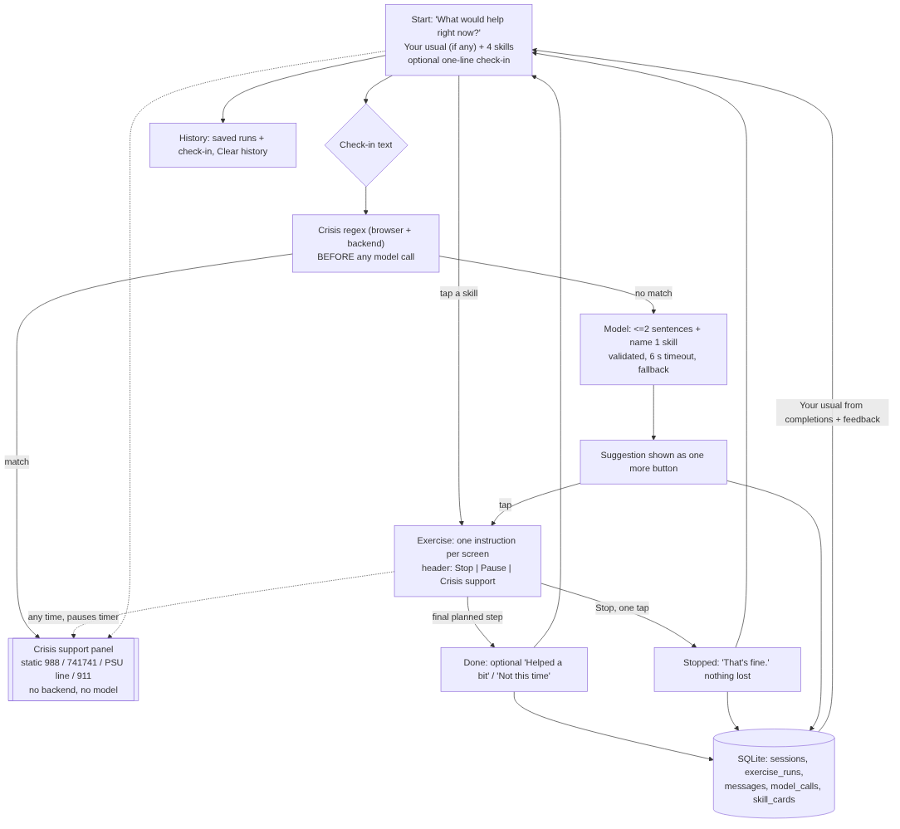

# Steady: design notes (Assignment 3)

Steady is a **coursework skills prototype**. It offers four brief skills (paced breathing, 5-4-3-2-1 grounding, STOP, a one-minute reframe), one at a time, with a crisis-support route that is always on screen. It is evaluated only with fictional scenarios. It is not a support tool and must not be offered to anyone as one.

This file is the Part 3.1 design, kept up to date. Where Parts 3.2/3.3 changed a decision, the change is marked **Changed in 3.x** with the reason.

---

## 1. Main experience

Source: [`flow.mmd`](flow.mmd). Screens, in order:

1. **Start**: "What would help right now?" Four skills as equal options (R4). If history shows a usual skill, it's listed first as "Your usual: …" with the plain reason ("Finished 3 times recently") (D5). An optional one-line check-in box sits under the options. Footer: *Less on screen*, *History*.
2. **Exercise**: one instruction per screen (D2). The header keeps only **Stop**, **Pause** (timed skills) and **Crisis support** (D1, D4).
3. **Done**: "Done." plus two optional taps, *Helped a bit* / *Not this time*. Ignoring them is fine (D3, D5).
4. **Stopped**: "Stopped. That's fine. Nothing else is needed." No confirmation dialog, no "are you sure", nothing lost (R3).
5. **History**: what was saved, in plain words, plus *Clear history*.
6. **Crisis support panel**: static content (988, Text LIONS to 741741, Penn State Crisis Line, 911). Opens from the header on every screen. It's bundled into the frontend, so it needs no backend, model or network (R2, D4).

## 2. Design decisions and the findings behind them

| Decision | Finding | What we gain | What we give up / alternatives considered |
|---|---|---|---|
| **Crisis support button in the header of every screen**, static content, opens over whatever is happening and pauses it | R2, D4 ("persistently" is load-bearing) | Reachable in one tap from anywhere, including mid-exercise, after a model failure, and with the backend down | Takes header space in a deliberately sparse UI. Considered a floating button (rejected: covers content on phones) and a button on the home screen only (rejected: D4 says people noticed when it disappeared inside an exercise) |
| **Crisis detection is a deterministic regex in both browser and backend, run before any model call** | §5 crisis rule; "a system prompt alone does not meet this requirement" | Crisis-like text never depends on the model and is never sent to it | Misses indirect phrasing and over-triggers on negations ("I'm not suicidal…", scenario S09). We accept false positives: showing resources is low-cost and dismissible. The button doesn't depend on detection at all |
| **Four options, not a router**. The model may *name* a skill, but it only appears as one more button | R4 (68 mentions: offered, not routed) | The person stays in charge of the journey | The model's suggestion can be wrong; it costs one tap to ignore |
| **One action per screen, no library/dashboard** | D2 (100 mentions) | Less to read and decide | Less "discoverability" of what's in the app |
| **Stop is one tap, no confirmation; stopping is recorded neutrally and never counts against a skill** | R3 (39 mentions; all 15 raised it on the stop task) | Leaving costs nothing | We lose a signal ("stopped = didn't help?"). We deliberately don't infer that |
| **Every exercise ≤ 90 s at its intended pace** (63 / 54 / 42 / 65 s) | R1 | Fits the window where attention held | Breathing is 6 cycles, not the 9 a 90 s run would allow. Chose ~60 s because ~60 s was "comfortable" |
| **Grounding asks for no typing**: notice silently, tap once per sense | D3 (148 mentions, heaviest on breathing and grounding) | Lowest emotional cost | No record of what they noticed (intended) |
| **Reframe keeps typing optional**: tap a common thought, skip evidence, ask for two alternative readings or write your own | D3; brief: "think carefully about the effort this asks" | Can be finished with zero typed characters | Pre-written thoughts may not match. "Something else" is always there |
| **Reframe text is not saved** | D3 (disclosure is emotional cost); privacy | Nothing sensitive persists | History can't show the reframe |
| **"Your usual" computed from history, no setup screen** | D5 (49 mentions; "use my usual skill") | Saves a choice without asking for configuration | Can be wrong. Mitigated: shown as one option, not auto-started; one "Not this time" counts double; *Clear history* resets it |
| **Contraction (D1) is user-chosen + structural, not detected**: exercise screens drop everything but Stop/Pause/Crisis; *Less on screen* on the start screen shows only one option + "More options" | D1 (but the study does not establish how to detect distress) | No false claims about knowing how someone feels | The person has to flip the switch themselves. We considered contracting when crisis text is detected (rejected: would tie D1 to an unreliable detector) |
| **Neutral, plain language; muted palette; motion only for breathing** | D6 (97 mentions: clinical = diagnosis, cheerful = condescension, saturated colour/motion = demand) | Calm, non-judgmental tone | Less "brand personality". Model outputs with "!", praise or clinical words are rejected by a validator (§3) |

## 3. Role of the model, and its limits

Adapted from the hotel RAG chatbot: **stored context + a constrained prompt + saved conversation**. The app, not the prompt, controls everything that matters for safety.

**The model may:**
1. **Check-in (optional box on Start).** Read what the person typed plus the two most relevant *skill cards* (retrieved from the `skill_cards` SQLite table by keyword overlap, the RAG step). Reply in at most two short sentences and name at most one of the four skills.
2. **Reframe assist (opt-in button).** Offer up to two one-sentence alternative readings of the thought the person entered. The person picks one, writes their own, or skips.

**The app controls (never the model):** skill steps and timing (`shared/skills.json`), Stop, saving, personalization, crisis detection and the Crisis support route.

**Limits enforced in code** (`backend/app/llm.py`):
- Output must be JSON in a fixed shape. The reply must be ≤ 280 chars and ≤ 2 sentences. A suggested skill not in the list of four is dropped.
- A validator rejects "!", praise ("great job", "proud of you"), advice ("you should", "you need to"), and clinical or monitoring words (diagnos-, disorder, therap-, symptom, monitor, medicat-, BPD). Rejected output becomes a fixed fallback line.
- 6 s timeout. Any error (timeout, network, bad key, invalid output) becomes a fallback line, and the exercise continues.
- Crisis-like text is never sent to the model (fixed reply + Crisis support panel).
- Live calls are capped at 50 (counter in SQLite). After that the app switches to mock responses.
- `LLM_PROVIDER=mock` is the default, so peer testing uses no paid calls.

## 4. Data saved (SQLite `backend/steady.db`)

| Table | What | Used for | Shown back? |
|---|---|---|---|
| `sessions` | one row per visit, *Less on screen* flag | grouping history | yes (date) |
| `exercise_runs` | skill, how chosen (menu/usual/suggested), status (completed/stopped), steps done, setup ms, duration ms, paused ms, optional feedback | personalization, timing evidence | yes (skill, finished/stopped, duration, feedback) |
| `messages` | check-in text both ways, source (mock/live_model/fallback/crisis_rule), crisis flag, suggested skill | conversation record | yes (expand per session) |
| `model_calls` | provider, ok, latency, error | verification of failures and the call cap | no (developer evidence) |
| `app_state` | `live_calls_used` | 50-call cap | on Start footer as provider label |
| `skill_cards` | four short skill descriptions | retrieval context for the model | no |

Not saved: reframe thoughts, evidence or alternatives. There are no accounts, and everything stays on the local machine. *Clear history* deletes sessions, runs, messages and model-call logs.

## 5. UI research (existing interfaces)

Looked at public screenshots and app-store pages of mainstream breathing/meditation apps and at how chat companions present themselves (no accounts created, no real conversations). What we took and what we rejected:
- **Breathing apps use an expanding shape that carries the pace.** Taken: the circle, with large "Breathe in/out" text and a count, because R1/D3 favour following over reading.
- **Home screens are often libraries, streaks and dashboards.** Rejected per D2/R3. Streaks turn stopping into a cost.
- **Companion chatbots invite long open-ended conversation.** Rejected. The check-in is one optional line, and the model can't ask follow-ups (D3: disclosure is emotional cost).
- **Crisis info is usually buried in settings.** Rejected per R2/D4.

## 6. Open questions (from 3.1) and what happened

| Question at 3.1 | Outcome |
|---|---|
| Should "Your usual" start automatically? | **No.** Kept as a first option, never auto-started (R4). |
| How many breathing cycles? 6 (60 s) or 9 (90 s)? | **6**, giving 63 s with the 3 s orientation. |
| Should STOP auto-advance or wait for taps? | **Auto-advance + Next.** Like breathing, the interface carries the pace (fewer decisions). |
| Should crisis-like input end the exercise? | **No.** The panel opens over the exercise and pauses it, and the person chooses whether to continue (R3/R4). |
| Is regex crisis detection good enough? | **Only as an extra, never as the route.** Over-triggered on "killing me" (fixed) and still over-triggers on negations (accepted, documented). |
| What happens if the tab is closed mid-exercise? | **Changed in 3.3**: the next visit records the run as *stopped*. Before that it stayed "started" forever (found in browser testing). |
| Should "Not this time" outweigh a completion? | **Changed in 3.3**: weight −2. With −1, two "helped" + three "not this time" still left the skill as usual. The person's own signal should correct the app quickly. |
